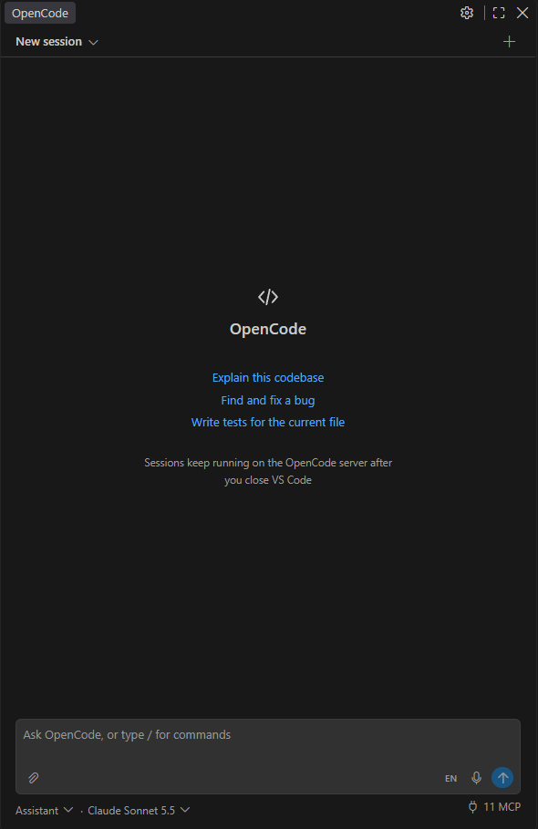
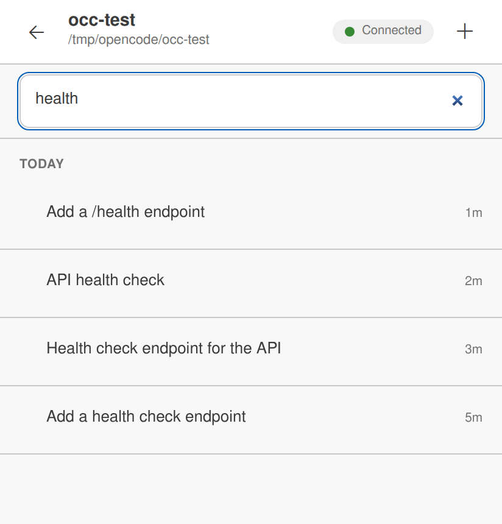
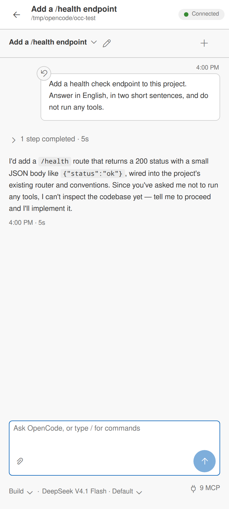

# OpenCode (unofficial) for VS Code

> **Unofficial.** This extension is made by SR Web Studio and is not affiliated with, endorsed by or supported by the OpenCode team. "OpenCode" is the name of their project, used here only to say what this extension works with. Official extensions: [OpenCode](https://marketplace.visualstudio.com/items?itemName=sst-dev.opencode).

A chat panel for [OpenCode](https://opencode.ai) V2 in the VS Code sidebar. Your sessions live on the OpenCode server, so they keep running when you close VS Code, and you find them again when you come back.

  

<em>The OpenCode panel in VS Code.</em>

  
  

<em>The Android app (beta) connected to the same OpenCode server.</em>

## Why I built this

I'm a big OpenCode fan. I run OpenCode as a service on a machine that is on 24/7, so I can open my sessions from anywhere, my laptop or my phone, and pick each one up exactly where it is, even hours later.

What I badly missed was the VS Code editor around it: opening files, native diffs, the terminal, all next to the chat. So I built this extension for myself, and it now helps me every day. Maybe it helps you too.

I'm also working on an Android app with the same UI, for the same always-on setup. It is **not part of this extension**: it is a separate APK, available as a **beta** from [GitHub Releases](https://github.com/sr-web-studio/opencode-vscode/releases) (see [Android app (beta)](#android-app-beta)).

**Preview:** this is an early release. Please report problems in [Issues](https://github.com/sr-web-studio/opencode-vscode/issues).

## Features

- **Chat** with the sessions of the open workspace folder. Compact one-line tool calls with details on click, finished turns folded into "N steps completed", collapsible reasoning.
- **Sessions in the chat:** the title-bar toggle (or **OpenCode: Toggle Sessions**) opens a list beside the chat, an overlay when the view is narrow. It is the one place to switch, create, rename, delete and archive sessions; the old folder and session dropdowns are gone. It lists the open folder's sessions; with several folders open it shows one collapsible group per project, the active one expanded. The ones that need you or are running stay on top, then the newest, and each row says what it needs with an icon and its words: a bell for a question or permission, a spinner while it runs, a red mark for a failed turn, a dot for a reply you have not read. The current session is highlighted, archived rows stay hidden until you ask for them, and rows keep their place while the pane is open. Click a row to open it in the folder that owns it; its pencil (or F2) renames the session and its trash deletes it after a confirmation.
- **Steer while it works:** a message sent while the agent is busy joins the running turn.
- **Editor integration:** file paths open in the editor (images too), and edits open as native VS Code diffs.
- **Terminal:** shell commands the agent runs show up in a read-only VS Code terminal, without stealing focus. Ctrl+C stops the running command, after asking. Closing the terminal or VS Code never stops it: the command keeps running on the server, and **Show terminal** on the tool line attaches again.
- **Permissions and questions** inline: `Allow · Always · Deny`, and question forms that stay fully readable.
- **Agent and model picker**, the current session's title (click it or press F2 to rename), pinned sessions, a floating task list, and background workers in a header chip. Click a worker to open it read-only.
- **Slash commands** in the prompt box (`/compact`, `/undo`, `/fork`, `/skills`, your own commands) and an **MCP servers** panel (`/mcps`) to check status, switch servers on or off and sign in.
- **Enhance prompt:** the sparkle button in the prompt box polishes a dictated or rough message (grammar, spelling, punctuation, sentence structure, speech-to-text slips) or rewrites it as a detailed, well-structured prompt for the agent. Undo puts the original back until you edit or send. It is one stateless call: only the prompt text is sent, never files, images or session history, and the session's agent and model are untouched. The model it uses is chosen in the button's menu (the server's default by default).
- **Delete a session** you no longer need (trash icon in the sessions pane, or **OpenCode: Delete Session…**): only stopped sessions, only after you confirm. It is deleted on the server for every client, with its workers. The extension never deletes anything on its own.
- **Pair your phone** with **OpenCode: Pair Mobile Device…**: choose the address of the OpenCode server that your phone can reach (Wi-Fi/LAN or Tailscale; the picker lists the server's addresses, never the phone's), then scan the QR code in the new panel with the [Android app (beta)](#android-app-beta). The code is one-time and expires after 5 minutes; nothing is sent to the internet. See [Connect the Android app](https://github.com/sr-web-studio/opencode-vscode/blob/main/docs/mobile-setup.md).
- **Notifications** when OpenCode needs you or finishes work.
- **Voice input**: speak into the prompt box. Free and offline on your own computer (one multilingual model for English and about 28 other languages, Bangla as an optional pack), or Soniox with your own key for mixed languages and many more. See [Voice input](#voice-input).

OpenCode stays in charge: models, providers, MCP servers, skills, agents and all configuration come from your OpenCode setup. The extension never changes OpenCode's configuration and never stops or restarts the OpenCode service.

## Requirements

- VS Code 1.144 or newer.
- [OpenCode](https://opencode.ai) V2 installed, so the `opencode` command works. If it is missing, the panel shows how to install it. You can also set **OpenCode: Set CLI Path**.
- An OpenCode server. If none is running, the extension starts OpenCode's shared background service (`opencode serve --service`), which keeps running on its own. To use a server on another computer, set `opencode.serverUrl` (see [Settings](#settings)); if that server has a password, run **OpenCode: Set Server Password**.

The workspace folder you open is the OpenCode project.

## Voice input

Click the mic in the prompt box, speak, and click again to stop. The text is added to the prompt; nothing is sent until you press Enter. Choose the engine with `opencode.voice.engine`:

- **`local` (default): free and offline. One multilingual model covers English (default) and about 28 other languages; Bangla is an optional extra pack.** The first time, it asks to download once (about 693 MB: the [sherpa-onnx](https://github.com/k2-fsa/sherpa-onnx) speech engine and the multilingual model; Bangla alone is about 179 MB). Every download is checked against a fixed checksum. After that nothing leaves your computer. The model is [NVIDIA Nemotron 3.5 ASR Streaming 0.6B](https://huggingface.co/nvidia/nemotron-3.5-asr-streaming-0.6b) and writes cased, punctuated text as you speak. Attribution: NVIDIA Nemotron 3.5 ASR Streaming 0.6B, OpenMDW-1.1; sherpa-onnx int8 export by csukuangfj. Licence: [OpenMDW-1.1](https://openmdw.ai/license/1-1/) (the text is in the companion's NOTICE). Languages with best accuracy: English, Spanish, French, German, Italian, Portuguese, Dutch, Turkish, Russian, Ukrainian, Arabic, Hindi, Japanese, Korean, Vietnamese; Polish, Swedish, Czech, Norwegian, Danish, Bulgarian, Finnish, Croatian, Slovak, Hungarian, Romanian and Estonian work with lower accuracy, Mandarin is weak. It needs about 1 GB of memory while you record. On a Ryzen 5 5600 it decodes faster than you speak (about 0.32 s of computing per second of speech with 2 threads).
  - **Active languages (up to 2 by default).** Run **OpenCode: Choose Voice Language** to tick the languages you speak (`opencode.voice.localLanguages`; the limit is `opencode.voice.maxLanguages`). The first one is the current language and the only one that records; one model runs at a time. Click the language label next to the mic (for example `EN`) or run **OpenCode: Switch Voice Language** to switch. Switching between languages of the multilingual model is instant; switching to Bangla loads another model (about 2 seconds). Languages you no longer use stay on disk until you remove them with **OpenCode Voice: Remove Downloaded Languages**.
  - Test builds before 0.3.7 had a single language setting (`opencode.voice.localLanguage`, `en` or `bn`). It still works: until you choose languages, it is your first active language. The English models of those test builds (about 200 MB) are deleted from the extension's storage folder after the first successful start with the new model.
- **`soniox`: cloud, with your own [Soniox](https://soniox.com) API key.** Better accuracy, mixed languages, many languages. Soniox charges you directly; there is no paid tier here. Create a key in the [Soniox console](https://console.soniox.com), then run **OpenCode: Set Voice API Key (Soniox)**. The key is checked, then stored in VS Code's secret storage. With this engine the mic stays dimmed until a key is set.

Recording is done by the small companion extension **OpenCode Voice (unofficial)**, which is installed automatically on the computer in front of you, also when you work over Remote SSH. On first use it checks the microphone permission and tells you how to fix it if it is blocked. Use **OpenCode Voice: Choose Microphone** to pick a device.

For Soniox, set your languages in `opencode.voice.languages` (default: `bn`, `en`). They are hints; other languages are still recognized.

## Settings

Open Settings and search for **OpenCode**:

| Setting | What it does |
| --- | --- |
| `opencode.serverUrl` | Address of an OpenCode server on another computer. Empty (default): use OpenCode on this computer. Examples: `http://192.168.1.10:4096`, `http://my-server.tail1234.ts.net:4096`, `https://opencode.example.com`. `http://` is added if you leave it out; `4096` is OpenCode's default port. |
| `opencode.cliPath` | Path to `opencode`. Empty: `PATH`, then `~/.opencode/bin`. |
| **OpenCode: Open Global Config** (command; on the OpenCode Settings page, "Edit config" in the MCP panel) | Opens your global OpenCode config (`~/.config/opencode/opencode.jsonc` or `.json`, or under `XDG_CONFIG_HOME` / `OPENCODE_CONFIG_DIR`) in an editor so you can edit it yourself. If there is none it asks before creating one. If `opencode.serverUrl` points at another computer, it tells you the config lives there. The extension never edits it. |
| **OpenCode: Open Project Config** (command; on the OpenCode Settings page) | Opens the active workspace folder's own OpenCode config: `opencode.jsonc` or `.json` in the folder, or `.opencode/opencode.jsonc` or `.json` (a `.opencode` file wins over the direct one, as in OpenCode). If the folder has none it asks before creating `opencode.jsonc` there. If `opencode.serverUrl` points at another computer, it tells you the config lives there. The extension never edits it. |
| **OpenCode: Rename Project** (command; in the sessions pane and on the OpenCode Settings page) | Changes the name OpenCode shows for the chat view's workspace folder in its browser UI and on the phone. With several folders open, each project group in the pane shows the name and its pencil renames that folder's project. A name set in the browser UI or on the phone shows up here live. This only changes the project's display name on the OpenCode server: it never renames the folder on disk and never edits OpenCode config. |
| `opencode.transcript.*` | Fold finished steps, expand tool details, reasoning display, font size. |
| `opencode.todo.defaultExpanded` | Show the task list expanded. |
| `opencode.notifications.*` | Which events notify you, and whether to notify while the window is focused. With the OpenCode Voice companion, an unfocused window also flashes its taskbar button (`os`: `auto`/`off`). |
| `opencode.terminal.*` | When to reveal terminals, one per session or per command, how many to keep open. |
| `opencode.voice.engine` | `local` (free, offline) or `soniox` (your own key). |
| `opencode.voice.localLanguages` | Active languages of the on-device engine; the first is the current one (default `["en"]`). Easier: **OpenCode: Choose Voice Language**, **OpenCode: Switch Voice Language**. |
| `opencode.voice.maxLanguages` | How many languages can be active (default 2, up to 5). Languages of the multilingual model cost nothing extra; Bangla is a separate download (about 168 MB). Only one model is loaded at a time. |
| `opencode.voice.localLanguage` | Deprecated single language (`en` or `bn`); still used while `localLanguages` is not set. |
| `opencode.voice.languages`, `opencode.voice.model` | Languages and model for the Soniox engine. |
| **OpenCode: Toggle Sessions** (title bar of the chat view) | Opens or closes the sessions list inside the chat. It is the only session list in the editor (the old dropdowns are gone): it lists the open folder's sessions, or with several folders open one collapsible group per project (the active folder expanded, with a folder icon and its session count, sessions indented under it), the ones that need you or are running first and then the newest. Each row and project header carries its status icon and words (needs your answer, running, failed, new reply, read) and an unread count; a project's own status stays at the end of its header, so a collapsed project still shows it. A session whose turn finished but whose workers still run shows a worker icon and "Worker running" without moving. Each project header has a `+` that starts a new session in that folder, and a single-folder window has a **New session** row at the top. Click a session to open it in its folder, use the row's pencil (or F2) to rename it and its trash to delete it (after the usual confirmation), the pencil on a project to rename it, the archive button to show or hide archived sessions, and the search to filter. Rows stay in place while the pane is open; the next open sorts again. On a narrow view the list overlays the chat and closes after you pick a session. |

## Android app (beta)

A separate Android app, **OpenCode (unofficial)** for phones, keeps every project and its sessions in one drawer on the same OpenCode server, with chat, diffs, command output and notifications when a session needs you or finishes. Each project shows a folder icon and its status at the end of the header, its sessions sit under it, a project's `+` starts a new session there, and a session whose workers still run says so on a second line.

- **Not shipped with this extension.** Installing the extension never installs anything on your phone. The app is a separate APK.
- **Beta.** Download the APK from the latest `mobile-v…-beta` pre-release on [GitHub Releases](https://github.com/sr-web-studio/opencode-vscode/releases) and install it on your phone (Android 7.0 or newer; allow installing apps from your browser or file manager). It is not in the Play Store yet.
- **Connect:** the phone needs an OpenCode server that listens on your network with a password. Then run **OpenCode: Pair Mobile Device…** in VS Code and scan the QR code in the app, or type the computer's address and the server password.
- **Setup guide:** [Connect the Android app to your OpenCode server](https://github.com/sr-web-studio/opencode-vscode/blob/main/docs/mobile-setup.md) — run the server, find its address, firewall and Tailscale, troubleshooting, security.
- **Privacy:** the app talks only to your server. The [privacy policy](https://github.com/sr-web-studio/opencode-vscode/blob/main/docs/privacy.md) says what it keeps on the phone, what it sends, and the one Google component (the QR scanner) that reports diagnostics to Google.
- Like the extension, it is not affiliated with the OpenCode team.

## Privacy

- The extension talks only to your OpenCode server. For voice input it also downloads the on-device engine once (npm registry and Hugging Face), or talks to Soniox when you choose that engine.
- Audio is recorded only while the mic button is on. With the `local` engine it never leaves your computer. Your Soniox key stays in VS Code's secret storage; the recorder receives a key that expires after two minutes, one per recording.
- No telemetry.

## Development

The repo is a Bun workspace monorepo: shared logic in `packages/core`, the Svelte UI in `packages/ui`, the VS Code extension and the OpenCode Voice companion in `apps/vscode`. Run `bun install`, then `bun run build`, `bun run typecheck`, `bun run test` and `bun run package` from the repo root. See [docs/DEVELOPMENT.md](docs/DEVELOPMENT.md), [docs/architecture.md](docs/architecture.md) and [docs/monorepo.md](docs/monorepo.md).

## License

MIT. Not affiliated with the OpenCode team.
